&nbsp;&nbsp;

 

### `>_` about

I've spent **11+ years in IT**, starting in Tier 1 support and moving almost immediately into Tier 2 escalations. From there I went into development, writing production code in a COBOL-style legacy language, then became a switch consultant administering the in-memory databases on **500+ network switches** across the West Coast. I've also worked as a **DevOps engineer** at a startup, running containerized workloads on a custom platform built over **k3s**.

Today I'm a **Help Desk Technician II** at a multi-clinic healthcare organization in Idaho's Treasure Valley, where my work spans the service desk and systems administration. I build the internal tools my team relies on: **Python + Flask** apps, usually in **Docker**, that automate onboarding through our ITSM platform's API, back up and search the knowledge base, and flag unanswered tickets in real time. All of it is built with HIPAA and patient data in mind.

Off the clock I run a multi-node **Proxmox** homelab: reverse proxies, DNS, monitoring, backups, home automation, and self-hosted everything.

### `>_` what i run

| domain | stack |
|:--|:--|
| **🔐 Identity & Access** | Hybrid Active Directory + Entra ID, PowerShell bulk provisioning, hardware security key MFA rollouts |
| **🖥️ Infrastructure & VDI** | VMware Horizon, Linux administration, Docker, Proxmox |
| **⚙️ Automation & Tooling** | Python, Flask, REST APIs: internal apps that take repetitive work off the service desk |
| **🛡️ Security & Compliance** | Security+, daily HIPAA work, author of an AI governance registry for safe AI adoption |
| **🌐 Networking** | In-memory databases on 500+ carrier switches, grounded in Network+ |
| **☁️ Cloud & Kubernetes** | DevOps on k3s, backed by Cloud+, Cloud Admin, and Secure Cloud Professional |

### `>_` credentials

Every badge links to its Credly verification.

### `>_` honors & community

- **Eagle Scout**, the highest rank in Scouting
- **Excellence in Robotics**: engineering, programming, and creative problem-solving
- **Operational Excellence**: recognized on the job for performance, reliability, and service quality
- **Volunteer at ATWD**, the All Things Web Development community
- **STEM Educator**, teaching workshops at public libraries

&nbsp;

<code>// signal refreshed weekly by GitHub Actions · end of transmission</code>

